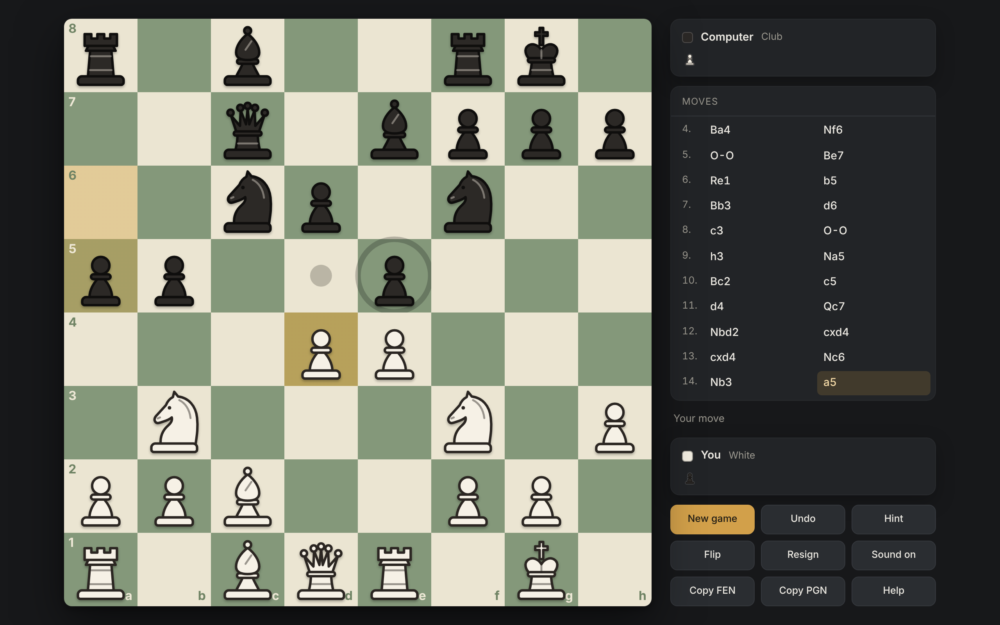

# Chess

A chess game against the computer in a single HTML file. No build step, no server, no dependencies: open `chess.html` in a browser and play.



**Play online:** https://gregorklaric.github.io/Chess/

## Features

- Full legal chess, written from scratch: castling with all conditions, en passant, promotion to any piece, check, checkmate, stalemate, threefold repetition, 50-move rule, insufficient material.
- Five difficulty levels, from deliberate blunders to strong club play.
- Engine runs in a Web Worker, so the board never freezes while it thinks.
- Click-to-move and drag-and-drop, legal-move markers, last-move and check highlights, animated moves.
- Move list in SAN; click any move to review the position, pieces glide between positions.
- Undo, hint arrow, flip board, resign, copy FEN / PGN.
- Original SVG piece set, synthesized sound effects (no audio files), mute toggle.
- Game is saved in the browser and restored on reload.
- Works on desktop and phone (stacks below 800 px wide).

## Difficulty levels

| Level | Approx. Elo | Behaviour |
|---|---|---|
| Beginner | 400–700 | One half-move deep, noisy judgement, about one move in three deliberately weaker |
| Improver | 1000–1300 | Three half-moves deep, slight noise, about one move in eight weaker |
| Casual | 1500–1700 | Full search, ~0.5 s per move |
| Club | 1700–1900 | Full search, ~1.5 s per move |
| Strong | 1900–2150 | Full search, ~4 s per move |

These are estimates, not measured ratings. They assume a reasonably fast desktop or laptop; on phones and older machines the time-based levels play roughly 100–200 Elo weaker.

## Engine

- 0x88 board, pseudo-legal move generation with legality check, Zobrist hashing.
- Negamax alpha-beta with principal variation search, iterative deepening, time limit per move, quiescence search, transposition table, null-move pruning, late-move reductions.
- Move ordering: hash move, MVV-LVA with static exchange evaluation (losing captures last), killer moves, history heuristic.
- Evaluation: material and piece-square tables tapered between middlegame and endgame, mobility, doubled / isolated / passed pawns, rook on open file / 7th rank / behind passed pawn, king safety (pawn shield, open files, attacks on the king zone).
- Endgame knowledge: exact king + pawn vs king table (opposition), drawn and drawish endings (wrong-coloured bishop, KNN, rook vs minor, opposite-coloured bishops, rook endings), mating technique for K+Q, K+R and K+B+N.
- Opening book of about 20 main lines.

## Tests

`perft.test.js` loads the engine directly from `chess.html` and checks move generation (perft on the start position, Kiwipete and three more reference positions), the rules, SAN/FEN, the evaluation knowledge and basic engine behaviour.

```
node perft.test.js
```

Requires Node.js; nothing to install.

## License

MIT, see [LICENSE](LICENSE).
